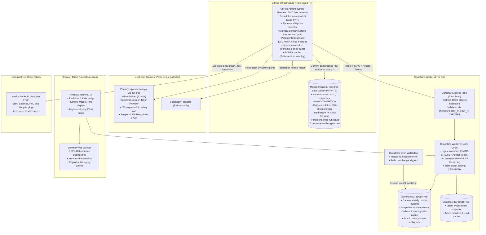

# PSX Research Lab — System Architecture

**Document Version:** 2.0.0 (Foundation Lockdown Verified)  
**Cost Posture:** Exactly $0.00 / month (No credit-card dependencies, free tiers only)  
**Topology:** 100% Cloud-Hosted (No always-on personal hardware, MacBook, Orange Pi, or VPS)  
**Repository Model:** Dual-Repository Split:
- **Application Repository (PUBLIC):** `MahadImran/psx-research-lab` (Code, architecture, CI workflows, tests, engineering portfolio showcase)
- **Data Archive Repository (PRIVATE):** `MahadImran/psx-research-data` (Immutable compressed market data `.json.gz`, daily cumulative SHA-256 manifests, disaster recovery state)

---

## 1. High-Level Architecture Topology

---

## 2. Core Architectural Decisions

1. **Dual-Repository Separation:**
   - The application codebase is intentionally public (`MahadImran/psx-research-lab`).
   - The financial data archive is strictly private (`MahadImran/psx-research-data`).
   - Under no circumstances does the public CI workflow leak private data archive tokens or raw third-party datasets into public build logs or artifacts.
2. **Single-Owner Collector:** Only ephemeral GitHub Actions runners run Python and query PSX endpoints. Public API user requests never trigger scraping.
3. **Session Token Extraction (`PSXTokenProvider`):**
   - Dynamic cookie and token negotiation extracts valid session credentials from PSX web endpoints.
   - Low-level network socket requests invoke `PersistentCoordinator.record_request()` to account for all network calls against quota.
4. **Market Trading Hours Awareness (`MarketCalendar`):**
   - All market hours are evaluated in `Asia/Karachi` (PKT, UTC+5).
   - Mon–Thu: 09:15–15:30 PKT.
   - Friday: 09:15–12:00 PKT (Session 1), 14:30–16:30 PKT (Session 2).
   - Post-close EOD reconciliation window: 15:30–18:00 PKT (16:30–19:00 on Fridays).
   - Out-of-hours collector triggers ping Healthchecks with skip reasons and exit cleanly without consuming upstream requests.
5. **Persistent Cross-Runner Coordination (`PersistentCoordinator`):**
   - Ephemeral GitHub runners coordinate through state stored in the private data repository (`state/budget_and_lease.json`).
   - A single-collector lease with a 15-minute TTL prevents overlapping runners.
   - Pre-reservation commits quota remotely *before* outbound socket calls, guaranteeing quota preservation across runner crashes.
   - Optimistic concurrency retries with exponential backoff on HTTP 409 conflicts.
6. **Immutable Durability (`DurableArchiveManager`):**
   - All upstream responses are gzipped (level 9) and sharded by `raw/YYYY/MM/DD/{source}_{endpoint}_{timestamp}_{hash8}.json.gz`.
   - Daily cumulative SHA-256 integrity manifests are committed to `manifests/YYYY-MM-DD.json`, accumulating files across all runs for the date without erasing morning snapshots.
   - Every commit undergoes immediate readback verification against the remote repository.
7. **Settlement Reconciliation (`EODReconciler`):**
   - Post-market daily reconciliation fetches official `POST /historical` datewise prices (712 symbols).
   - Discrepancies between preliminary intraday quotes and final settlement prices are flagged as revisions (`revision = 1`) and audited.
8. **Deterministic Client-Side Backtesting:**
   - AI is treated strictly as a compiler from natural language to structured JSON DSL.
   - Financial mathematics, portfolio accounting, and backtesting execute deterministically in the client's browser Web Worker.
