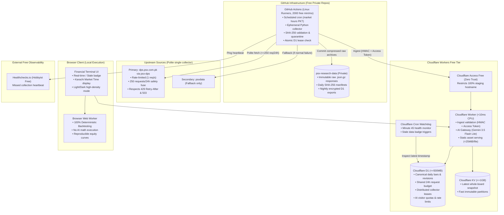

# PSX Research Lab — System Architecture

**Document Version:** 1.0.0 (Milestone 0 & 1)  
**Cost Posture:** Exactly \$0.00 / month (No credit-card dependencies, free tiers only)  
**Topology:** 100% Cloud-Hosted (No always-on home Mac, Orange Pi, or VPS)

---

## 1. High-Level Architecture Topology

---

## 2. Core Architectural Decisions

1. **Single Owner Collector:** Only the ephemeral GitHub Actions runner runs Python and hits PSX endpoints. User request handlers never trigger scraping.
2. **Ephemeral Runners & Data Durability:** GitHub Actions runners are destroyed upon completion. All raw data is gzipped and committed to the private `psx-research-data` repository with SHA-256 manifests before ingestion into Cloudflare D1.
3. **Persistent Request Fuse:** A hard 250-request/24-hour limit is tracked in D1 and checked before every upstream request across all runners.
4. **Deterministic Math:** Gemini AI strictly compiles natural language into a versioned JSON DSL (`ExperimentSpec`). The browser Web Worker executes all calculations deterministically.
