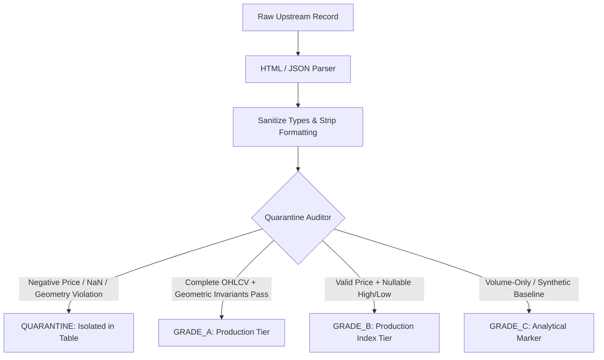

# PSX Research Lab — Data Quality Audit & Source Specification

**Status:** APPROVED  
**Date:** 2026-11-02  
**Target:** Pakistan Stock Exchange (PSX) Data Ingestion & Storage Pipeline  

---

## 1. Upstream Data Sources & Format Reality

PSX Research Lab interfaces with upstream PSX data interfaces to extract historical and intraday market observations.

### 1.1 Source Inventory & Endpoints

| Source Adapter | Upstream Host | Ingestion Mode | Data Granularity | Authentication |
| :--- | :--- | :--- | :--- | :--- |
| **`psx-dps` (Primary)** | `dps.psx.com.pk` | HTTP GET / POST | Intraday Snapshots, EOD Summary, Index Aggregates | Dynamic Session Token & Cookie |
| **`psxdata` (Secondary)** | `psxdata.com` | HTTP GET | Historical Daily EOD Bars, Sector Breakdowns | Unauthenticated Web Endpoint |
| **`psxpert` (Historical Seed)** | Offline Archive Fixtures | Static File Ingestion | Multi-Year Daily OHLCV Seed | Static / Local File Archive |

---

## 2. PSX Data Schema Realities & Nullability Rules

A critical finding of our empirical source audit is that **upstream PSX feeds do not uniformly provide complete OHLC candles across all endpoints**.

### 2.1 Index Summary Table (`/dps_table.php`)
- **Observed Behavior:** Upstream HTML table fragments for benchmark indices (`KSE100`, `KSE30`, `KMI30`, `ALLSHR`) frequently omit intraday High and Low values in summary rows.
- **Empirical Runner Extraction Example:**
  ```json
  {
    "index": "KSE100",
    "current": 166409.25,
    "change": 812.44,
    "percentChange": 0.49,
    "high": null,
    "low": null,
    "volume": 840495291
  }
  ```
- **Architectural Decision:** Treating `high` and `low` as non-nullable floats caused 100% of index summary rows to be rejected. Schema definitions in `packages/shared/src/schemas/market.ts` and `QuarantineAuditor` were updated to treat `high` and `low` as `Optional[float]`.

### 2.2 Equity Symbol Summary Bars
- Equity daily bars contain full OHLC values.
- Where High and Low are present, strict geometric invariants are enforced:
  $$\text{High} \ge \max(\text{Open}, \text{Close})$$
  $$\text{Low} \le \min(\text{Open}, \text{Close})$$
  $$\text{High} \ge \text{Low}$$
  $$\text{Volume} \ge 0$$
  $$\text{Close} > 0 \quad \text{and} \quad \text{Open} > 0$$

---

## 3. Data Quality Classification System

To guarantee that downstream backtesting and analytics engines never consume corrupted records while preserving valid index observations, we introduced a 4-tier Data Quality Grade:



### 3.1 Grade Definitions

| Grade | Identifier | Characteristics | Allowed Destinations |
| :--- | :--- | :--- | :--- |
| **Tier 1** | `GRADE_A` | Full OHLCV candle. `High >= max(Open, Close)`, `Low <= min(Open, Close)`. No nulls. | Production D1 `daily_bars`, Backtester, Analytics Engine |
| **Tier 2** | `GRADE_B` | Valid Close/Current price and Volume. Nullable High/Low (Index summaries). | Production D1 `daily_bars`, Benchmark Tracking |
| **Tier 3** | `GRADE_C` | Synthetic baseline or partial volume tick without full price bounds. | Diagnostic Analytics, Volume Aggregation |
| **Quarantine** | `QUARANTINE` | Geometric violations, negative prices, NaNs, missing timestamps. | Quarantine Logs, Alert Trigger; **Blocked from Backtester** |

---

## 4. Sanitization & Normalization Protocol

Before validation and archiving, all raw inputs undergo deterministic normalization:
1. **Number Formatting:** Pakistani numerical formatting (e.g. `166,409.25` with commas) is cleaned and parsed to standard IEEE 754 floating-point numbers.
2. **Timestamp Alignment:**
   - Raw dates are anchored to the Karachi market timezone (`Asia/Karachi`, UTC+5).
   - Ingestion timestamps are stored in strict ISO 8601 UTC format (`YYYY-MM-DDTHH:MM:SSZ`).
3. **Symbol Canonicalization:**
   - Equity tickers are trimmed and capitalized (e.g. `"SYS " -> "SYS"`).
   - Benchmark index tickers are mapped to canonical constants (`KSE100`, `KSE30`, `KMI30`, `ALLSHR`).
4. **Idempotent Deduplication:**
   - Payloads are hashed using SHA-256 (`recordHash`).
   - Identical hashes across consecutive polling cycles are classified as `DATA_UNCHANGED` to prevent duplicate D1 writes.

---

## 5. Known Upstream Limitations & Tolerances

1. **DPS Index Scraping Latency:** PSX DPS updates index web fragments asynchronously; intraday ticks can lag physical floor execution by 30–90 seconds.
2. **End-of-Day Settlement Adjustments:** Final closing prices may undergo minor official revisions up to 30 minutes post-session close (16:30 PKT). The reconciliation module detects and logs price revisions (`PRICE_REVISION_DETECTED`).
3. **Historical Data Gaps:** Historical seed data prior to 2018 may contain intermittent holidays without formal notices. The calendar validator treats unannounced closures gracefully as `MARKET_CLOSED`.
